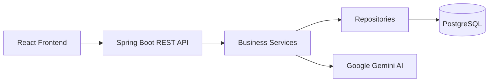
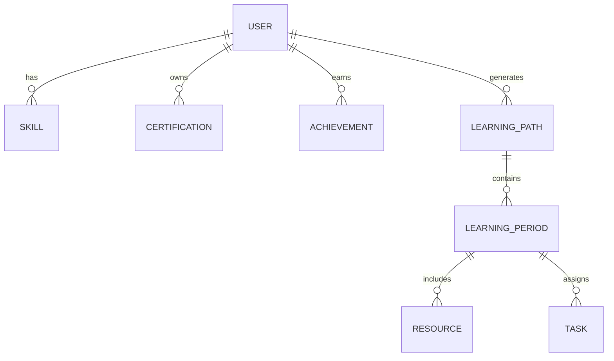
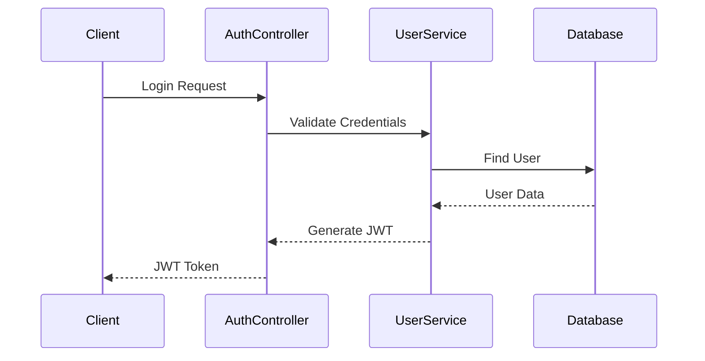
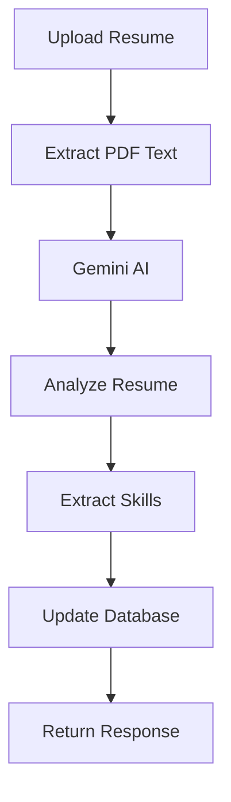
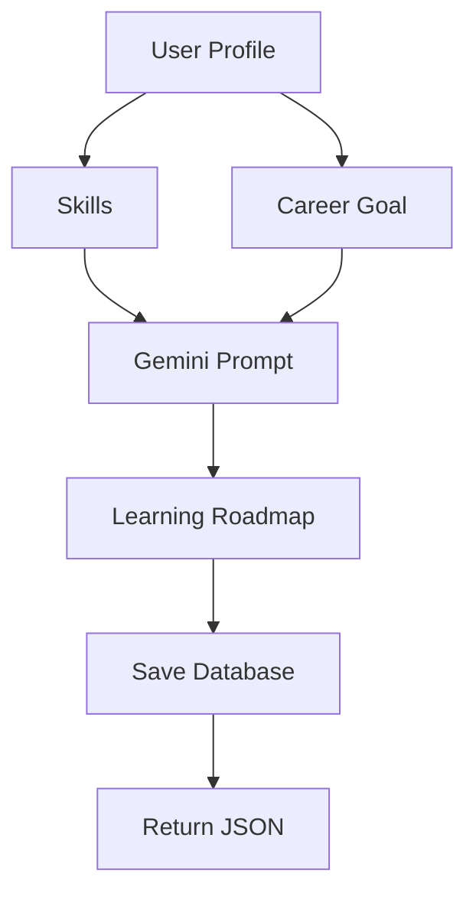

# 🚀 PrepWise Backend

> AI-powered career development platform built with **Spring Boot**, **PostgreSQL**, **JWT Authentication**, and **Google Gemini AI**.


---

# 📖 Table of Contents

- Overview
- Features
- Tech Stack
- System Architecture
- Project Structure
- Database Design
- Authentication Flow
- Resume Analysis Flow
- Learning Path Generation
- REST API Documentation
- Installation
- Configuration
- Running the Application
- Future Enhancements

---

# 📌 Overview

PrepWise is an AI-powered career development platform designed to help students and professionals improve their career journey.

The backend provides secure REST APIs for:

- User Authentication
- Profile Management
- Resume Analysis
- AI-powered Skill Extraction
- Personalized Learning Path Generation
- Progress Tracking

Google Gemini AI is integrated to intelligently analyze resumes and recommend customized learning roadmaps.

---

# ✨ Features

## 🔐 Authentication

- User Registration
- User Login
- JWT Authentication
- Password Encryption
- Secure API Authorization

---

## 👤 User Profile

Users can

- Update Profile
- Add Skills
- Manage Certifications
- Track Achievements
- Update Career Goals

---

## 📄 Resume Analysis

Users upload a PDF resume.

The backend

- Extracts PDF Text
- Sends Data to Gemini AI
- Identifies Skills
- Finds Experience
- Detects Certifications
- Suggests Improvements
- Updates User Profile Automatically

---

## 🎯 AI Learning Path

Based on

- Current Skills
- Career Goal
- Experience Level

Gemini generates

- Learning Roadmap
- Weekly Tasks
- Recommended Courses
- Projects
- Milestones

---

# 🛠 Technology Stack

| Category | Technology |
|------------|------------|
| Language | Java 21 |
| Framework | Spring Boot |
| Security | Spring Security |
| Authentication | JWT |
| ORM | Spring Data JPA |
| Database | PostgreSQL |
| AI | Google Gemini |
| HTTP Client | WebClient |
| Build Tool | Maven |

---

# 🏗 System Architecture



---

# 📂 Project Structure

```
src
└── main
    ├── java
    │
    ├── config
    │     ├── SecurityConfig
    │     ├── JwtUtil
    │     └── GeminiConfig
    │
    ├── controller
    │     ├── AuthController
    │     ├── UserController
    │     ├── ResumeController
    │     └── LearningPathController
    │
    ├── service
    │     ├── UserService
    │     ├── ResumeService
    │     ├── GeminiService
    │     └── LearningPathService
    │
    ├── repository
    │
    ├── entity
    │
    ├── dto
    │
    ├── exception
    │
    └── util
    │
    └── resources
          application.properties
```

---

# 🗄 Database Design



---

# 🔐 Authentication Flow



---

# 📄 Resume Analysis Flow



---

# 🎯 Learning Path Flow



---

# 🌐 REST API

## Authentication

| Method | Endpoint | Description |
|---------|----------|-------------|
| POST | /api/auth/signup | Register User |
| POST | /api/auth/login | Login User |
| GET | /api/auth/validate | Validate Token |

---

## User

| Method | Endpoint | Description |
|---------|----------|-------------|
| GET | /api/user | Get Profile |
| PUT | /api/user | Update Profile |

---

## Resume

| Method | Endpoint | Description |
|---------|----------|-------------|
| POST | /api/resume/upload | Upload Resume |
| POST | /api/resume/analyze | Analyze Resume |

---

## Learning Path

| Method | Endpoint | Description |
|---------|----------|-------------|
| POST | /api/learning-path | Generate Learning Path |
| GET | /api/learning-path/{id} | Get Learning Path |
| DELETE | /api/learning-path/{id} | Delete Learning Path |

---

# ⚙ Configuration

## Environment Variables

```properties
DB_URL=

DB_USERNAME=

DB_PASSWORD=

JWT_SECRET=

JWT_EXPIRATION=

GEMINI_API_KEY=
```

---

# 🚀 Installation

Clone Repository

```bash
git clone https://github.com/yourusername/prepwise-backend.git
```

Move into Project

```bash
cd prepwise-backend
```

Install Dependencies

```bash
mvn clean install
```

Run Application

```bash
mvn spring-boot:run
```

Application starts on

```
http://localhost:8080
```

---

# 📦 Example API Request

## Login

```http
POST /api/auth/login
```

```json
{
  "email":"john@example.com",
  "password":"password123"
}
```

Response

```json
{
  "token":"JWT_TOKEN",
  "username":"John Doe"
}
```

---

# 🔒 Security

- JWT Authentication
- BCrypt Password Encryption
- Stateless Sessions
- Input Validation
- CORS Configuration
- Global Exception Handling

---

# 📈 Future Improvements

- Google Login
- GitHub Login
- Email Verification
- Resume Score Dashboard
- AI Interview Assistant
- Docker Support
- Kubernetes Deployment
- Redis Cache
- Swagger Documentation
- CI/CD using GitHub Actions

---

# 👨‍💻 Author

Developed as part of the **PrepWise Career Development Platform**.

Built using **Java**, **Spring Boot**, **PostgreSQL**, and **Google Gemini AI**.
